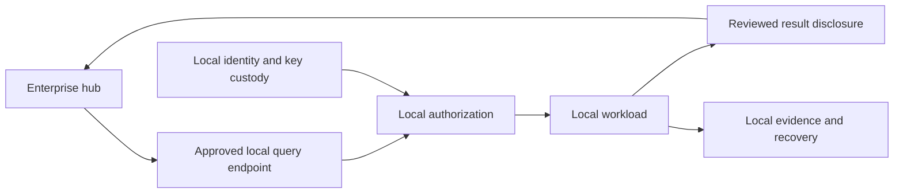
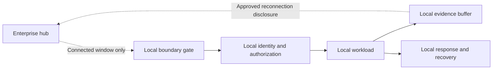
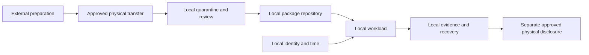
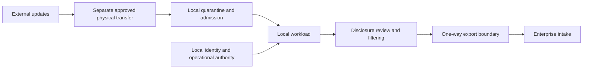

# 02 — Connectivity architecture patterns

These four diagrams are reference designs. Sovereignty boundaries and network connectivity are separate decisions. The runnable lab verifies a container with no external network interface; it does not deploy these four architectures.

## Connected Sovereign

## Intermittent

## Strict Air Gap

## One Way Export

| Pattern | Permitted network direction | Updates and evidence | Interruption behavior |
| --- | --- | --- | --- |
| Connected sovereign | Explicitly authorized ingress and egress | Locally reviewed, registered paths | Specify dependency and disclosure failure behavior |
| Intermittent | External paths only while connected | Local buffering and reviewed reconnection | Preserve declared local actions; mark central evidence unavailable or stale |
| Strict air gap | Local network only; no external network path | Separately approved physical transfers | Local identity, time, packages, evidence and response are required design decisions |
| One-way export | Local-to-external network direction only | Updates require a separate permitted mechanism | Export failure must not grant an opposite-direction path |

**Assumptions:** operator eligibility, trust material, local time, package completeness, supplier support, transfer custody and recovery still need environment-specific evidence. One-way arrows are not proof of a deployed data diode. Import quarantine and release-signature verification are future implementation work.

[Flow contracts](flow-register.json) · [Threat model](../docs/threat-model.md) · [Isolation evidence](../docs/verification.md)
