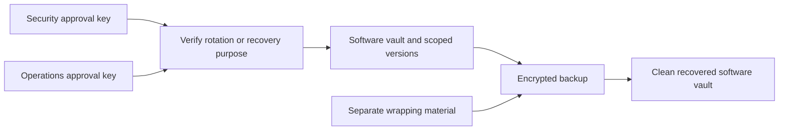

# 08 — Key custody and recovery

[Vault implementation](../assurance/crypto.py) records scoped key versions, rotates after two independently signed approvals, retains old versions for decryption, and encrypts backups with separate wrapping material. Recovery verifies security and operations approval signatures before decrypting key material. [Key-custody register](../templates/key-custody-register.md) identifies the deployment decisions.

Hardware custody is **simulated by software roles and local cryptographic keys**. No HSM, threshold encryption or physical separation was exercised. The wrapping key, approval roots and replay protection require durable, separately controlled deployment arrangements.

[Completion and measured evidence](contributions-08-28.md) · [Expanded verification](expanded-verification.md) · [Primary references](expanded-references.md)
