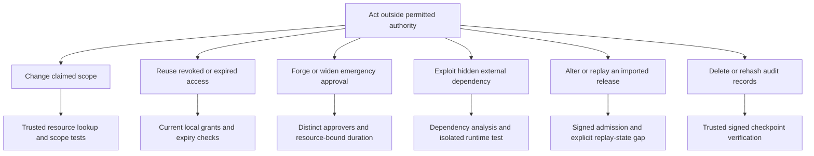

# 03 — Threat model: synthetic disconnected site

**Scope:** three logical industry/site fixtures, a trusted local resource store, ephemeral identity state, loopback HTTP, and a disposable container without external networking.

**Assets:** scoped business records, role authority, session credentials, approvals, clock assumptions, local dependency declarations, flow contracts and evidence.

**Trust boundaries:** public request versus trusted identity/resource scope; one site/tenant versus another; ordinary action versus emergency authority; local runtime versus external dependencies; preparation environment versus isolated runtime.

**Adversaries:** an authenticated user seeking another tenant's record; a compromised service identity; a user replaying access after revocation; a requester spoofing or reusing approvals; and a supplier or administrator introducing an undeclared external dependency.

| Threat | Mechanism and legitimate-use baseline | Negative evidence | Stage |
| --- | --- | --- | --- |
| T1: cross-site or tenant access | Own record is readable; resource scope comes from the trusted store | Another site's or tenant's record is denied, including a caller-supplied tenant query | Tested reference |
| T2: excessive action authority | Analyst can acknowledge a synthetic alert | Viewer and service reader cannot approve emergency access | Tested reference |
| T3: access survives role/user revocation | Current local role grants are checked on every action | Existing session is denied after role removal or identity revocation | Tested reference |
| T4: expired or invalid time extends access | Finite bounded durations and observed clock floor | Exact expiry, backward clock, non-finite or unavailable time fail closed | Tested reference; clock floor is not durable |
| T5: forged emergency authority | Two distinct authenticated human approvers in the same scope | Fabricated, duplicate, self or wrong-scope approvals are denied; approved access is resource-bound and expires | Tested reference |
| T6: disconnected local workflow secretly needs hub/IdP/registry/license | Declared local dependency graph is available without external nodes | External-only alternatives become unavailable; local clock/cache loss propagates | Tested model, not deployment discovery |
| T7: incompatible network direction or unreviewed disclosure | Valid declared contract is accepted | External network in strict-gap model, inbound one-way flow, missing owner/review/approval, and late quarantine are rejected | Tested contract checker, not firewall enforcement |
| T8: imported package compromise | Quarantine, pinned signer, destination, compatibility, provenance and two-duty approval checks | Changed bytes, wrong signer/site/builder/subject, insufficient approvals and in-session replay are denied | Tested synthetic bundles; durable replay state remains absent |
| T9: host, hypervisor or local administrator compromise | Container restrictions reduce the lab's runtime authority | No claim against a compromised host or privileged operator | Outside demonstrated scope |
| T10: loss of durable identity/evidence state | Design needs protected persistence and recovery ownership | Lab intentionally uses volatile state and is not a production IdP | Planned operational hardening |
| T11: audit deletion or rehashing | Signed count/head checkpoint retained as trusted input | Truncation and rehashed replacement fail against the checkpoint | Tested reference; independent checkpoint custody absent |
| T12: stale evidence becomes a current assurance claim | Explicit evidence-age categories | Aged/future/unverified reports cannot support the all-sites-current conclusion | Tested model; collector verification flags are trusted fixtures |
| T13: matching location claim is mistaken for residency | Separate declarations from independent evidence | Matching claims remain unverified; conflicting regions are flagged | Tested assessment model; no remote attestation |
| T14: prompt text grants tool or retrieval authority | Trusted local resource scope and explicit tool-action map | Cross-scope retrieval, shell tools and viewer write actions are denied | Deterministic fixture; no real-model robustness claim |

Evidence: [identity tests](../tests/test_identity.py), [HTTP tests](../tests/test_service.py), [dependency tests](../tests/test_dependencies.py), [flow tests](../tests/test_flows.py), and [verification](verification.md).

Expanded evidence: [crypto/update tests](../tests/test_assurance_crypto.py), [policy/evidence/AI tests](../tests/test_assurance_policy.py) and [measured 08–28 verification](expanded-verification.md). A fresh in-memory admission gate accepting an old release is explicitly recorded as an unsafe gap.

**Open question:** which claims remain valid after replacing ephemeral fixtures with an actual identity provider, isolated package service and durable evidence store?
